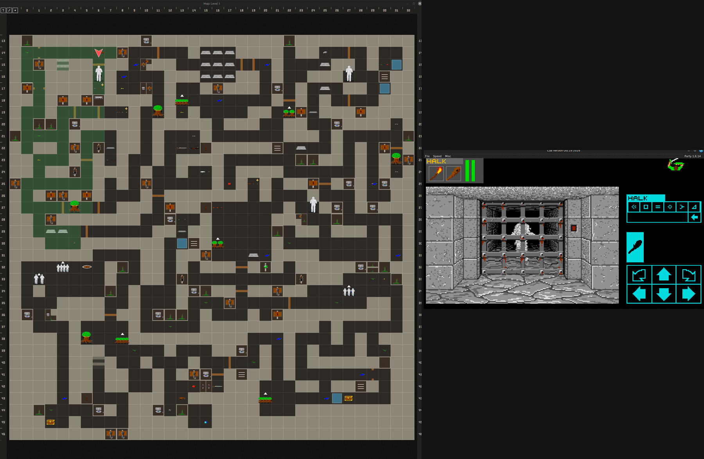
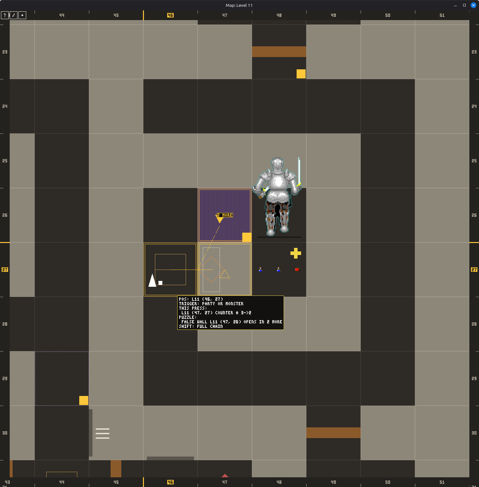
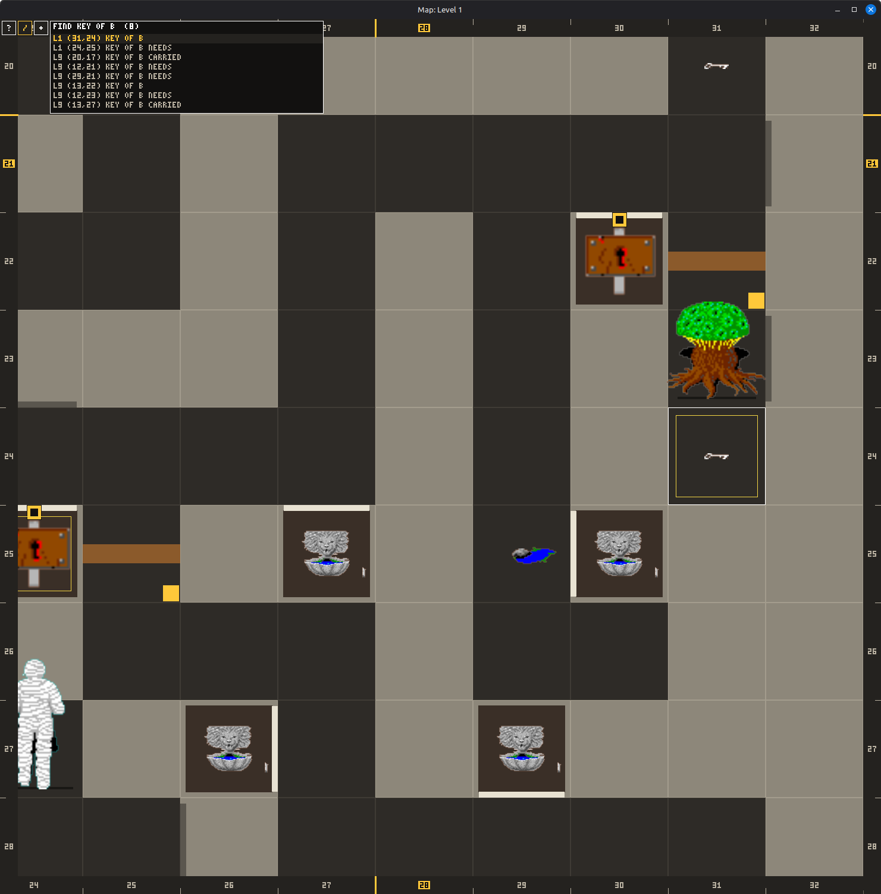
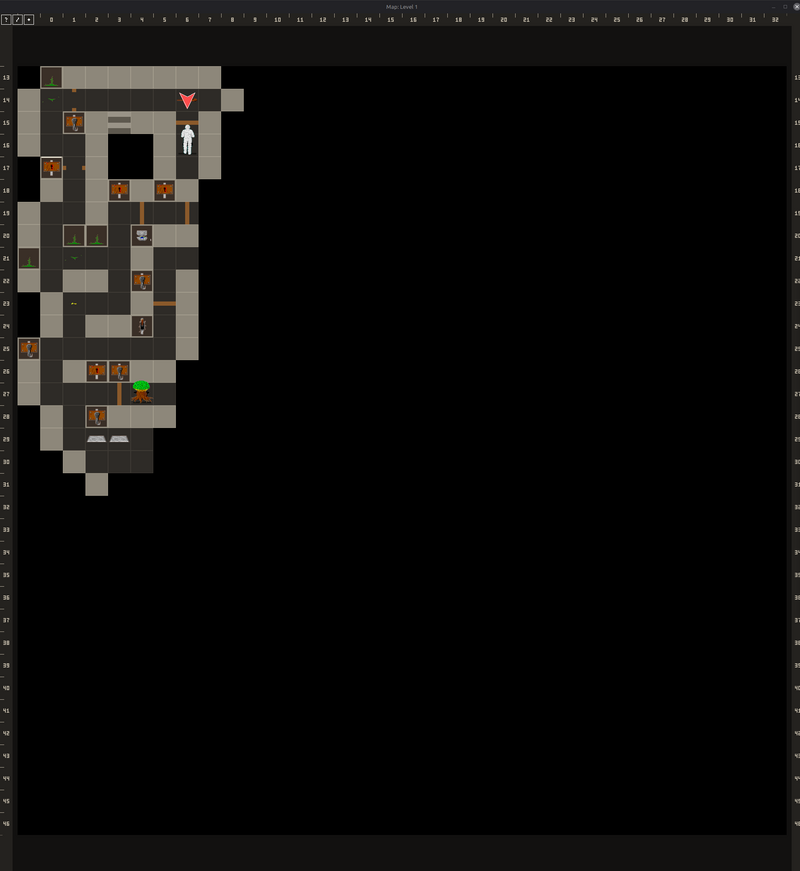
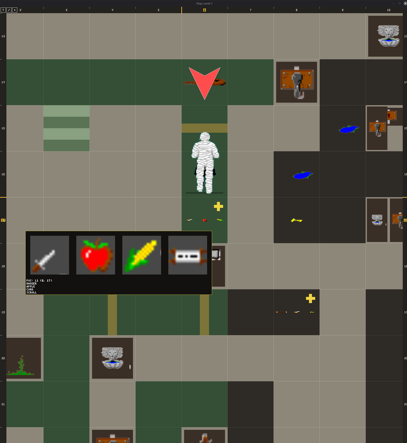
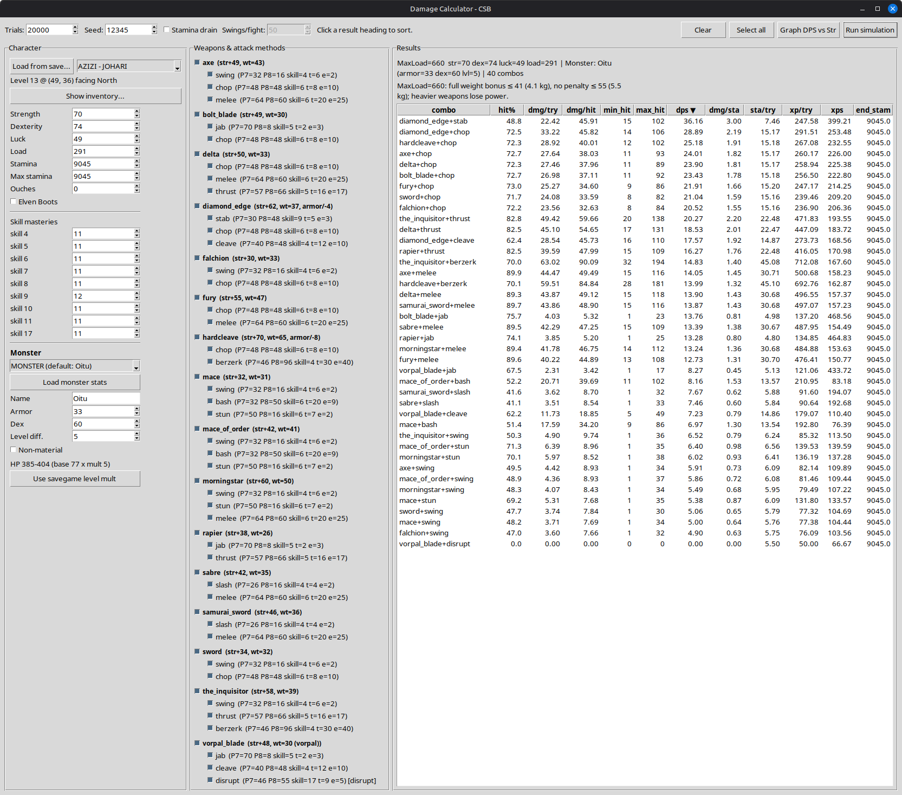
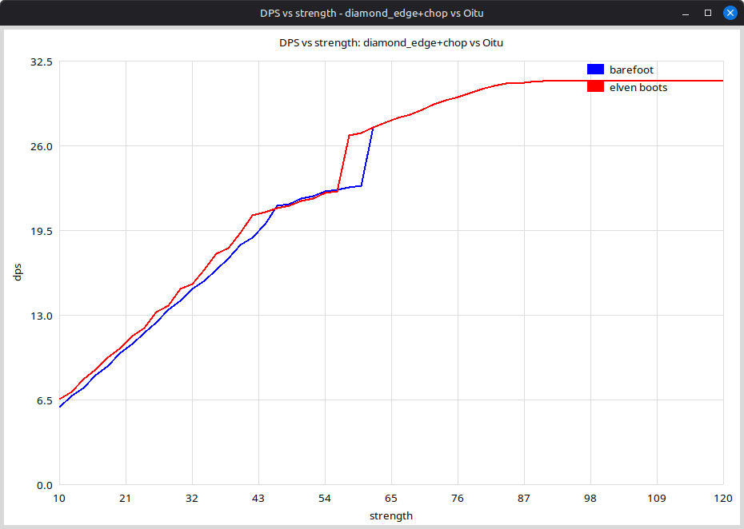

# CSBwin Automap

A live, spoiler-aware map for **CSBwin**, the reverse-engineered port of FTL's
*Dungeon Master* and *Chaos Strikes Back*. The map opens in its own window
beside the game and is drawn with the game's own wall, door and item pictures.
The game builds on Linux, macOS and Windows.



The map draws what the party has seen and worked out: the cells it explored,
the walls and items it noticed, the doors and pits, and which switch opened
which door. You decide how much it gives away, from strictly what your party
saw to the whole dungeon laid open.

**[Read the user manual](docs/automap-manual.md)** for every control and
setting.

## Download

Ready-to-run builds for Windows and Linux are on the
**[Releases page](https://github.com/codebrewster/CSBWin-With-Automap/releases/latest)**.
They hold the game engine with the map. The game itself, its sounds and its
fonts come from other packages; put them all into the folder you unpacked,
next to the program:

1. **The game (required):** `dungeon.dat` and `graphics.dat` from Paul
   Stevens' Dungeon Master package, for
   [Windows](http://dianneandpaul.net/CSBwin/Games/DM_Windows_x86-32_20171117.zip)
   or [Linux](http://dianneandpaul.net/CSBwin/Games/DM_Linux_X86-64_SDL2_20230127.tar.gz).
2. **Sounds, main font and icon (strongly recommended):** the `sounds` and
   `fonts` folders and `lsb.bmp` from
   [csb64.7z](http://raine.1emulation.com/archive/csb/csb64.7z), the package of
   the CSBwin Linux port ([forum topic](https://www.dungeon-master.com/forum/viewtopic.php?t=31666)).
   Without them, monsters move in silence.
3. **Text fonts (recommended):** [Diogenes](https://www.dafont.com/diogenes.font)
   and [Olde English](https://www.dafont.com/olde-english.font) from dafont,
   into `fonts`, named `diogenes.ttf` and `OldeEnglish.ttf`.
4. **Play:** start `csb.exe`, or `./csb` on Linux, and open the map with
   **Misc → Map → Window**.

Copy only the files named above: the other packages also hold a program and a
`csb.cfg` that would replace this one. `HOW-TO-PLAY.txt` in each release
package walks through every step.

The Linux build needs SDL2 (`sudo apt install libsdl2-2.0-0` on Debian and
Ubuntu) and a system from 2024 or later (glibc 2.38: Ubuntu 24.04, Debian 13,
Fedora 39); on older systems, build from source.

## Features

### A map that follows the party

- A second, resizable window that updates while you play, drawn with the
  original game artwork.
- Zoom with the wheel, pan with the middle button, and step between levels with
  the mouse side buttons. Rulers along the edges show the coordinates.
- Follows the party's level, or stays locked on any level you pick.
- Three vision modes: **fog of war**, **explored, live**, and **whole level**.
- Remembers how each cell looked: doors open or shut, pits, floor and wall
  pictures, and the items left on the floor.
- Keeps its memory in a `.map` file beside each saved game.

### A map that does not spoil the dungeon

- Three spoiler levels: **seen**, **learned** (the default), and **all**.
- Wall decorations, switches and writing appear only once the 3D view has shown
  enough of them to be noticed, and light matters.
- Hidden machinery (pads, relays, hidden pits, teleporters, false walls) stays
  hidden until the party learns of it.
- Chest contents need the chest opened; scroll text needs the scroll read.

### Ask the map what things do

Hover a cell for a tooltip. It tells as much as your spoiler level allows:

- **Always:** items on the floor, what a chest holds once opened, monsters with
  the damage you dealt them, doors and stairs.
- **From learned on:** what a switch or pad is linked to, once the party saw
  its target change, and which key a lock takes, once a key opened it. Hover a
  door to see the switches known to act on it.
- **At all:** the whole truth. Where teleporters lead and how spinners turn
  you, which key every lock wants, what each monster generator creates, and the
  full chain behind a switch, through relays, counters and gates to the doors
  and walls at the end, with badges such as `NOW`, `2 MORE`, `1 BIT OFF` and
  `BLOCKED`.

A legend behind the **?** button explains every mark on the map.

### Find what you have seen

- Press `/` or Ctrl+F to search every level for items by name: on the floor,
  in a chest or alcove, needed by a lock or pad, or carried by a monster.
- The arrow keys step through the hits and jump the map to each one.
- The search keeps the spoiler rules: nothing in an unopened chest is found.

### Keep your own notes

- Right-click a cell to mark a hidden pit you suspect, or draw your own guessed
  link between cells.
- Notes are drawn in their own colour at every spoiler level, and saved with the
  map.

### Testing aids

- With `map_debug = 1` in `csb.cfg`: teleport the party, spawn monsters, raise
  skills, change the light, freeze monsters, and forget what the map knows. Made
  for testing the map, handy for trying out custom dungeons. See the
  [manual](docs/automap-manual.md#testing-aids-debug-mode).

## Screenshots

| | |
|---|---|
|  |  |
| Hovering a pad at spoiler level all: two more presses open the false wall | Searching for KEY OF B across levels, including the locks that need it |
|  |  |
| Fog of war: only the corner the party has explored | Hovering a pile: item names and the contents the map remembers |

More screenshots are in the [user manual](docs/automap-manual.md).

## Building from source

You need the game data (`dungeon.dat` and `graphics.dat`). It is not part of
this repository; see [Game data and community](#game-data-and-community).

- Linux and macOS: [BUILDING.md](BUILDING.md)
- Windows: [BUILDING-WINDOWS.md](BUILDING-WINDOWS.md)
- How to use the map: [docs/automap-manual.md](docs/automap-manual.md)
- Code map and internals: [docs/automap.md](docs/automap.md)
- Visibility rules in detail: [docs/automap-visibility.md](docs/automap-visibility.md)
- All documentation: [docs/README.md](docs/README.md)

Build the game and run the tests (Linux and macOS):

```sh
make -C src RELEASE=1
make -C src test
```

Put the game data and the engine's own files into one folder, and start the
game from inside it. `csb.cfg` holds the key bindings and settings; without it
the game has no keyboard shortcuts.

```sh
mkdir -p Dungeons/Dungeonmaster
cp /path/to/dungeon.dat /path/to/graphics.dat Dungeons/Dungeonmaster/
cp -r csb.cfg en.txt fr.txt locale Dungeons/Dungeonmaster/
cd Dungeons/Dungeonmaster
../../src/csb
```

`Dungeons/` is ignored by git, so game data and saves never end up in a commit.

Open the map from the menu bar at the top of the game window with
**Misc → Map → Window**. It opens with the game
from then on, until you close it.

## How it works

The map is fed by two hooks: one after every drawn 3D frame, and one on every
engine tick. The drawing and memory rules live in engine-free units that the
test program exercises, while a thin reader/recorder layer is the only part
that touches the game. That split is what makes the visibility rules testable
without running the game. [docs/automap.md](docs/automap.md) describes the
whole design.

## Python tools

`src/` also holds a few Python 3 scripts that grew out of the work on the
engine. They need nothing beyond the standard library (Tkinter for the GUI) and
are not part of the game build.

- **`damage_calc.py`**: a Monte-Carlo port of the game's physical-attack
  maths. Set up a champion, weapons and a monster, and it prints hit chance,
  damage per hit, damage per second, stamina cost and experience for each
  weapon and attack.
- **`damage_calc_gui.py`**: the same simulation in a window. Tick weapons and
  attacks, pick and edit a monster, edit the champion or load one from a
  DM/CSB savegame, even straight off an Amiga save disk image (`.adf`), then
  sort the results. **Graph DPS vs Str** plots damage per second against
  strength, barefoot and with Elven Boots.
- **`dps_graph.py`**: that plot on its own, for one weapon and attack.
- **`dm_save_to_csbwin.py`**: makes a classic Amiga *Dungeon Master* 2.0 save
  loadable by CSBwin.
- **`convert-Amiga20-to-Amiga36.py`**: converts an Amiga 2.0 save to the 3.6
  layout.
- `savefile.py`, `adf.py` and `dmitems.py` are the libraries behind them: the
  savegame reader, a read-only Amiga disk image (ADF) reader, and the item
  names, the latter generated from the item table of
  James Jacobs' Multi-game Character Editor (MCE).





```sh
cd src
python3 damage_calc_gui.py
python3 dm_save_to_csbwin.py DMGame.dat
```

[docs/python-tools.md](docs/python-tools.md) explains each script and the C++
it mirrors.

## Game data and community

CSBwin was written by Paul R. Stevens by reverse-engineering the Atari ST
version of *Chaos Strikes Back*. The original CSBwin sources and binaries are
published at <https://www.dianneandpaul.net/CSBwin/> and described on the
Dungeon Master Encyclopaedia:

- <http://dmweb.free.fr/community/clones/chaos-strikes-back-for-windows-and-linux-raspbian-macos-x-pocket-pc/>
- Dungeon Master Encyclopaedia: <http://dmweb.free.fr/>
- Dungeon Master forum: <https://www.dungeon-master.com/forum/>

Downloadable binary packages on those sites contain the game data and the
optional sounds and fonts. The repository itself ships neither the game data
nor those optional files.

## Credits

- CSBwin and the original reverse engineering: Paul R. Stevens.
- The SDL2 Linux port this tree builds on: the CSBwin Linux community.
- Original games, artwork and game data: FTL Games / Software Heaven, Inc.
- Automap, Windows build and documentation:
  [codebrewster](https://github.com/codebrewster).
- Bundled libraries: [Dear ImGui](https://github.com/ocornut/imgui),
  [SDL_sound](https://github.com/icculus/SDL_sound) and
  [dr_mp3](https://github.com/mackron/dr_libs), under their own licenses.

## License

CSBwin is **not** GPL and not freeware; the underlying game remains the
property of its rights holders. See [COPYING](COPYING) for the full statement
before redistributing anything from this repository.
