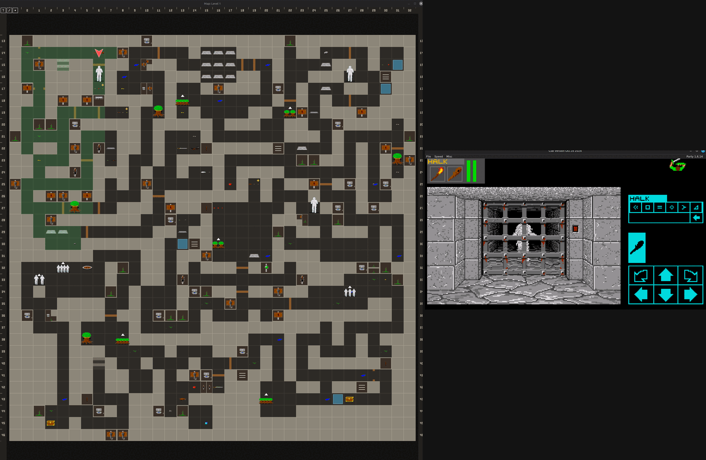
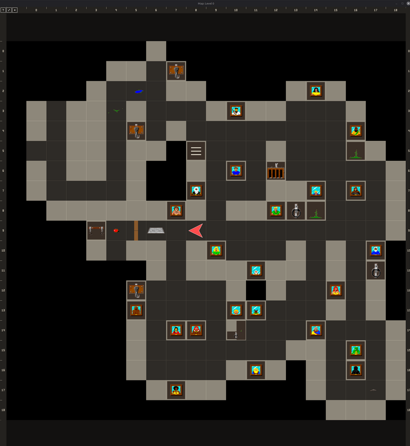
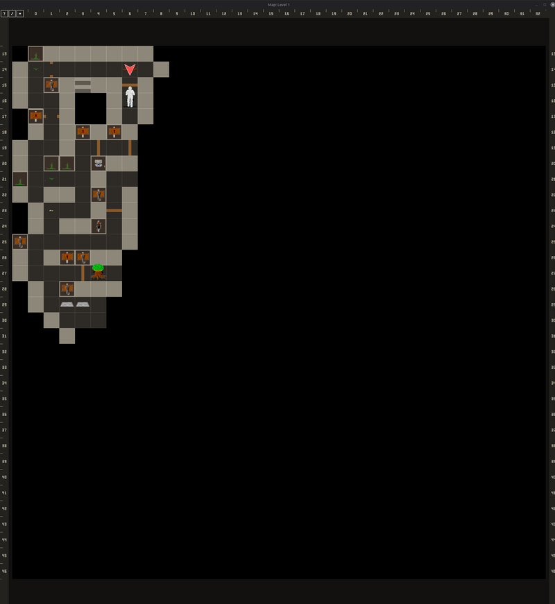
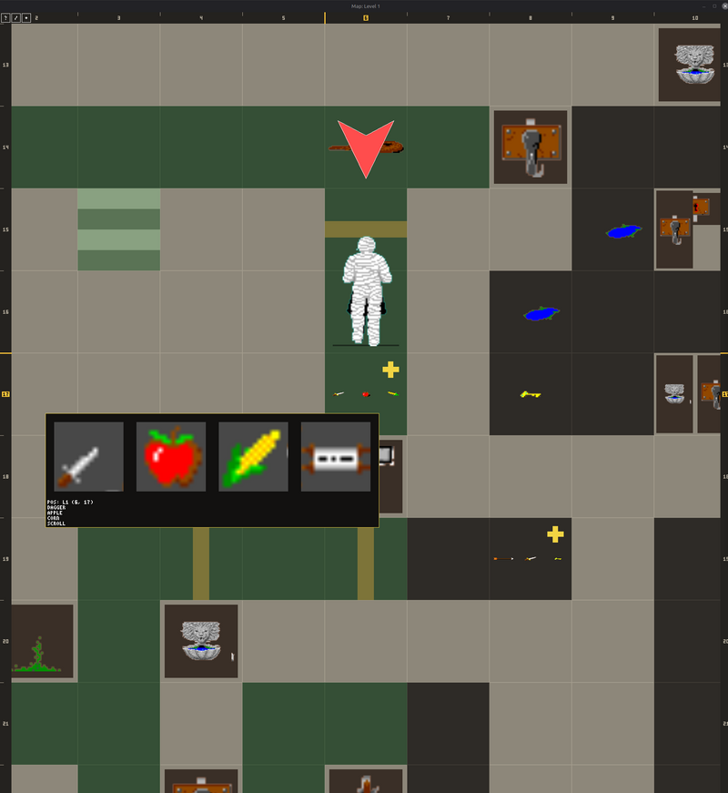
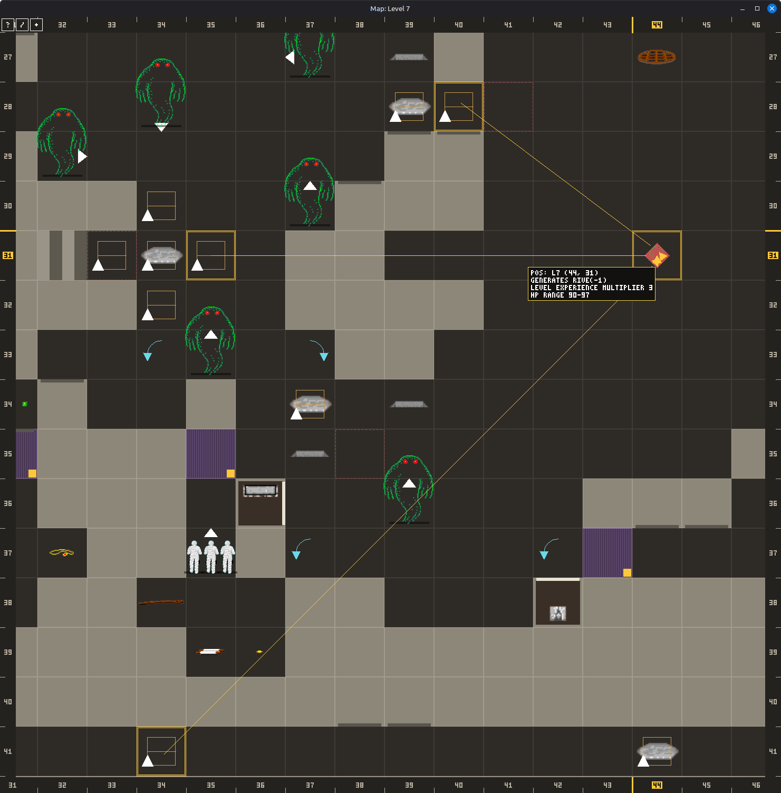
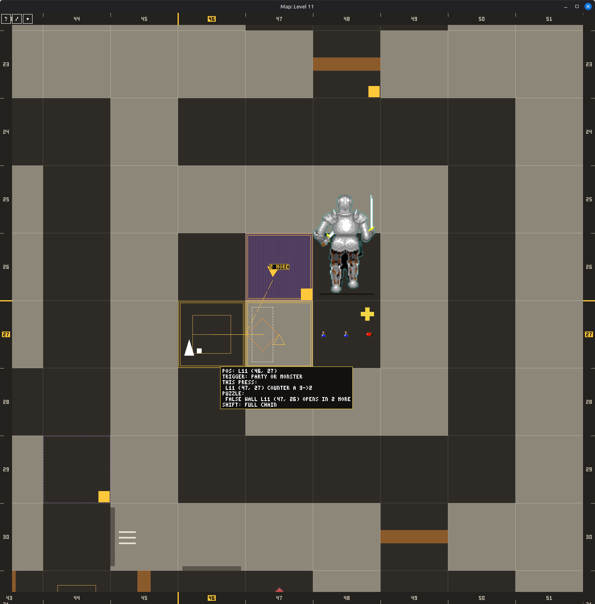
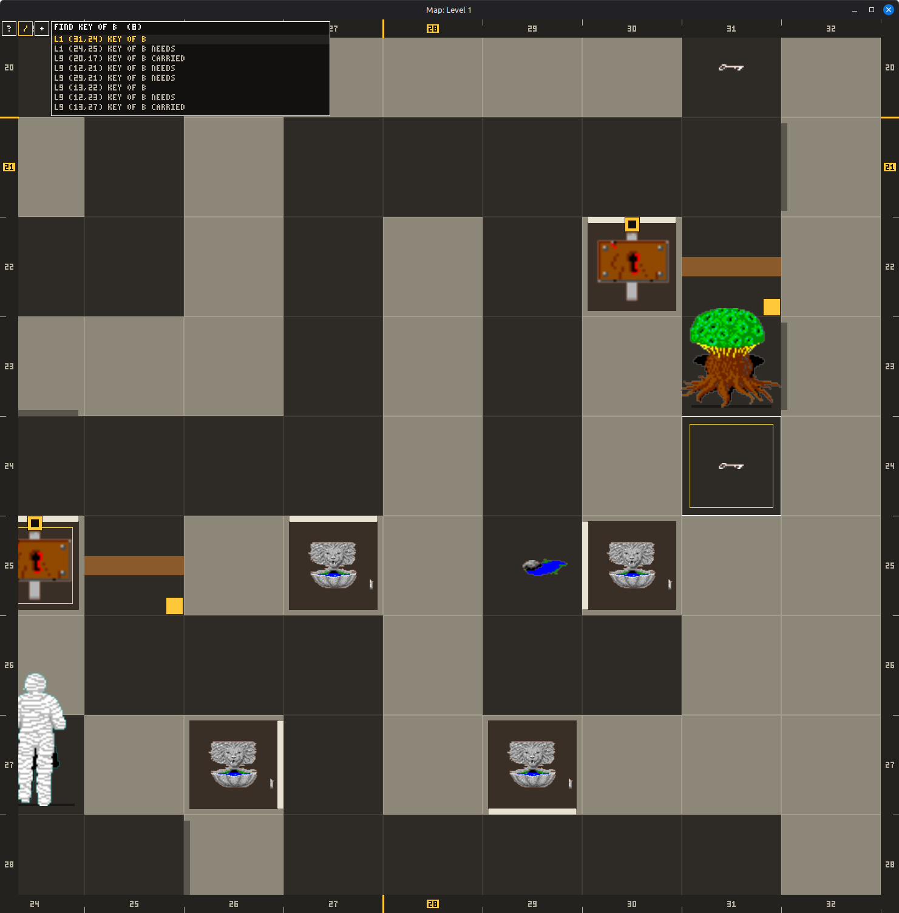

# Automap user manual

How to use the automap while you play. For how it is built, see
[automap.md](automap.md); for the exact rules of what counts as seen, see
[automap-visibility.md](automap-visibility.md).



## Contents

- [Opening the map](#opening-the-map)
- [The window](#the-window)
- [Moving around](#moving-around)
- [Vision and spoilers](#vision-and-spoilers)
- [What the map remembers](#what-the-map-remembers)
- [Tooltips](#tooltips)
- [Tracing switches and pads](#tracing-switches-and-pads)
- [Searching](#searching)
- [Controls help](#controls-help)
- [Your own notes](#your-own-notes)
- [Saving](#saving)
- [Settings in csb.cfg](#settings-in-csbcfg)
- [Testing aids (debug mode)](#testing-aids-debug-mode)

## Opening the map

In the menu bar at the top of the game window, choose **Misc → Map**. The map opens in a
second window that you can move and resize, and it updates while you play. If the window was open
when you left the game, it opens again the next time, at the same place and size.

Every other map setting is on the bar at the top of the map window; see
[The window](#the-window).

## The window

- The level is drawn with the game's own floor, wall, door, decoration, item and creature
  pictures, not with abstract tiles. The map's own marks (badges, plates, lines) are pixel shapes
  and the game's 3×5 font.
- The party is the red arrow, pointing the way it faces. Monsters stand where the game places them on
  their tile (a group of four in a 2×2, medium monsters side by side or one behind the other, a large
  monster, and usually a lone one, in the middle), each with a small white triangle showing the way it faces.
- **Rulers** run along all four edges and show the dungeon's coordinates. The row and column of
  the cell under the pointer are marked in yellow, so a position such as `L4 (12, 3)` is easy to
  read off.
- The window title names the level shown, for example `Map: Level 7`.

### The bar

A strip above the map holds every map setting:

| Button | What it does |
|---|---|
| **<** and **>** | One level up or down |
| **L7 ▾** | Opens the level list; see below |
| **FOLLOW** | On while the map follows the party's level; click to follow again |
| **VISION** FOG, EXPLORED, ALL | Fog of war, Explored live, or Whole level; see [Vision and spoilers](#vision-and-spoilers) |
| **TINT** | Only with VISION ALL: tints the cells the party has explored |
| **SPOILERS** SEEN, LEARNED, ALL | How much the map tells |
| **SHOW** | Kinds of things to draw; reads `SHOW: 3 HIDDEN` while any are off |
| **/** | The search |
| **?** | The controls help |
| **+** | The testing aids, only with `map_debug = 1` |

In a narrow window the long labels shorten (`EXPL`, `LRND`); if the bar still does not fit, the
wheel over it scrolls it.

### The level list

Click the level on the bar for a list of every level. The shown level is gold, the party's level
has the red arrow, and levels the party has not visited yet are grey and say `NOT VISITED`. While
a search is open, each level shows its number of hits. The wheel scrolls the list, typing a number
jumps to that level and **Enter** shows it, a click on a row shows that level, and **Escape** or a
click outside closes the list.

## Moving around

| Input | What it does |
|---|---|
| Left-drag | Pans the view; the map stops following the party |
| Mouse wheel | Zooms towards the pointer, from the whole level down to about three cells across |
| Middle-click | Centres the view on the party again and follows it |
| Mouse side buttons | Back goes down a level, forward goes up, centred on the tile under the pointer |
| Page Down / Page Up | Goes down / up a level over the middle of the view |
| Ctrl+Page Down / Ctrl+Page Up | The same from the game window, where the plain keys pick up items in the default `csb.cfg` |

Zoomed out to the whole level, the view follows the party again. The side buttons are the quickest
way to follow stairs and pits between levels.

## Vision and spoilers

Two independent settings on the bar decide how much the map shows. **Vision**
decides *where* the map draws; **Spoilers** decides *how much it tells* about
what it draws.

| Vision | What is drawn |
|---|---|
| **Fog of war** (default) | Only the cells the party has explored. Monsters, missiles and spell clouds show only while the party can see them |
| **Explored, live** | The explored cells, with monsters and moving things shown live on all of them |
| **Whole level** | The whole level, explored or not. **TINT** tints the explored part |

| Spoilers | What the map tells |
|---|---|
| **Seen** | Only what the 3D view has shown |
| **Learned** (default) | Also what the party has worked out by watching, such as which pad opened which door |
| **All** | Everything the dungeon holds, including what a switch will do before you press it |

At **Seen** and **Learned** the map keeps the dungeon's secrets the way the
game does:

- Wall decorations, switches, alcoves and writing appear only after the 3D
  view has shown enough of them to be noticed. Light matters: in the dark,
  less is noticed. Writing seen from afar is only scribbles, so it appears
  when you are close.
- The same goes for floor pictures (puddles, moss, pads) and stairs: a tile
  you only glimpsed past a corner shows as plain floor until you see what lies
  on it.
- Each item in an alcove appears on its own once it stood out; a cheese in
  the dark does not give away the bread beside it.
- A champion's mirror shows only its frame until you have stood in front of
  it, as the 3D view does.
- Hidden machinery (pads, relays, counters, generators, hidden pits,
  teleporters, false walls) stays hidden until the party learns of it.
- A chest's contents need the chest opened, and a scroll's text needs the
  scroll read.
- A breakable door looks like any other door.

### What the map draws

**SHOW** on the bar switches kinds of things on and off: weapons, armour, potions, scrolls,
chests, food, keys, other items, monsters, wall decorations, wall writing and floor decorations.
**SHOW ALL** and **HIDE ALL** set them all at once. Hiding an item kind also hides it in alcoves and
on altars. Floor decorations are the dressing only (grates, moss, flame pits, cracks, puddles):
pressure pads and pits always show. Hidden things still turn up in the search and in the tooltip.

**Wall decorations** sit in a square against the face they hang on, with a short line on that face:
bright for a switch the map knows about, dark brown for anything else. On a pillar, decorations on
neighbouring faces move apart so they never overlap. What lies in an alcove shows as a small icon
in the lower right of its square, the key a lock wants in the lower left in a gold frame.

**Pads** are the game's own plate picture; a pad without one (a hidden pad) is the plate drawn
faint with a dotted edge. A small dark badge in the lower left says who sets it off: the party's red
arrow (turned the way the party must face, gold frame), claw marks for monsters, the item's own
icon, or arrow and icon when the party must carry the item. Teleporters use the same badge for who
they take, with a box for objects. A generator shows its monster faded with a `GEN` badge.

**Stairs** carry a plate with an arrow and the level they lead to. A **teleporter** is a cyan
checkerboard; one to another level shows that level's number. A pile of more than three items shows
its count in the upper right.

## What the map remembers

The map draws cells the way the party last saw them, not the way they are now.
A door that closed behind your back still shows open until you look again.

- **Cells:** doors open or shut, pits open or closed, and the floor and wall
  pictures.
- **Items** on the floor, where they were last seen. A `?` marks something only
  glimpsed in the dark.
- **Links** between a switch or pad and what it operates, once the party has
  seen the effect.
- **Damage** the game showed for each monster you fought.





## Tooltips

Hover a cell for a tooltip. What it lists depends on what is there and on the
spoiler level.

At every level:

- **Items**, stacked by name (`3X SKELETON KEY`), and what a chest or alcove
  holds once the party has looked. A brewed potion has its power rune in front, as in the
  inventory: `UM VEN POTION`.
- **Monsters**, with the damage the game showed for each group member.
- **Doors and stairs.**

From **Learned** on, also:

- **Links** from a switch or pad to the cells the party saw change.
- **The key a wall lock takes**, once a key in hand has opened it.

At **All**, also:

- **Where teleporters lead** and **how spinners turn** the party.
- **What every lock needs**, such as `NEEDS SOLID KEY (S)`.
- **What sets off a pad**, such as `TRIGGER: PARTY OR MONSTER`.
- **Monster generators**: what they create and its hit point range.
- **The monsters' hit points**, under the damage lines.
- **The whole press chain** of a switch or pad; see
  [Tracing switches and pads](#tracing-switches-and-pads).

Hovering a cell that something else acts on, such as a door or a generator,
draws lines from every switch and pad linked to it that the spoiler level
allows.

A tooltip that does not fit the window shows a `+N MORE` line. Hold **Shift**
and turn the wheel to scroll it.





## Tracing switches and pads

Hover a switch, lever or pad to see what it is linked to. Its lines start at one point (the
switch's face or the pad's centre) and run as thick pixel lines to where they enter their targets,
while the rest of the map dims. At **Learned** the map draws the links the party has seen work, with
an open arrowhead: the party saw the target change, not which signal did it. Hovering a cell that
something acts on, such as a door or a generator, draws the lines from every switch and pad linked
to it.

Hovering a teleporter draws a cyan line to where it sends you; hovering a cell teleporters land on
draws the lines from them; a dormant teleporter shows a dashed dim line to where it would send you.

At spoiler level **All** the map follows the whole chain. Hovering a switch or pad walks its signal
through relays, counters, gates and DSAs to the doors, pits and walls at the end, through explored
cells only. The tooltip then has two parts:

- **THIS PRESS** lists what the next press reaches first, for example
  `L11 (47, 27) COUNTER A 3->2`.
- **RESULT** lists every goal behind it and how far it is, for example
  `FALSE WALL L11 (47, 26) OPENS IN 2 MORE`, `1 BIT OFF` or
  `BLOCKED: COUNTER AT 0`. A goal that comes late says so at the end:
  `DOOR L11 (49, 25) OPENS ON THIS PRESS, AFTER 6 TICKS`.

On the map each goal gets a frame and a badge: `NOW`, `2 MORE`, `1 BIT OFF`, `NEEDS OTHERS`,
`BLOCKED`, `HOLD`, `DSA` or `DONE`. Goals that happen now, soon or already are gold; those that wait
on something else are orange. Hovering a relay draws what feeds it in blue and what it feeds in gold.

When a counter, gate, DSA or local action sits between the press and a goal, the tooltip ends with
`SHIFT: ROUTE`: hold **Shift** to see the ROUTE. A line one step further in only happens when the
line above lets the signal through:

```
ROUTE:
  COUNTER A L11 (47, 27)
    COUNTS 3 -> 2
    AT 0: (IN 2 MORE)
      FALSE WALL L11 (47, 26) OPENS
      GATE A L11 (48, 25), SETS BIT 1, AFTER 6 TICKS
        BITS 0101 -> 0111, NEEDS 0111
        BIT 2 FROM: SWITCH (W) L11 (50, 24)
        ON MATCH: (IN 2 MORE)
          DOOR L11 (49, 25) OPENS
```

The door sits under the gate's `ON MATCH:`, which sits under the counter's `AT 0:`: it needs both.
Under each counter or gate come, one step in, what this press does to it (grey: `COUNTS 3 -> 2`,
`BITS 0101 -> 0111, NEEDS 0111`, `ONCE ONLY`), then when it passes the signal on (cyan: `AT 0:`,
`ON MATCH:`), with the same words RESULT and the badges use: `(THIS PRESS)`, `(NEXT PRESS)`,
`(IN 2 MORE)`, `(NEEDS OTHER SOURCES)`, `(BLOCKED: COUNTER AT 0)`. What it sends sits one further in;
goals are gold.

A gate also lists, in grey, the other inputs that reach it and are not on this route
(`BIT 2 FROM: SWITCH (W) L11 (50, 24)`; a pad, counter, gate or DSA is named the same way). A
normally-closed gate sends `ON NO MATCH:`. A gate that only reacts to some messages says so after a
comma: `ONLY WHEN A BIT CHANGES`, `ONLY WHEN THE MATCH CHANGES`, `ONLY WHEN A BIT CHANGES BUT THE
MATCH DOES NOT`, `ONLY ON SET`, `ONLY ON CLEAR`, `ONLY WHEN THE BIT TURNS ON` or `ONLY WHEN THE BIT
TURNS OFF`, for example `ON NO MATCH, ONLY WHEN THE MATCH CHANGES: (NEXT PRESS)`.

A DSA reads `IF ITS PROGRAM PASSES IT ON (NOT FOLLOWED)` with nothing below it, and
steps after it in the same cell end in `(IF DSA PASSES)`. A message that comes back to a step on the
route reads `LOOPS BACK TO COUNTER A L11 (47, 27)`. A switch or pad wired straight to its goals has no
route and shows no hint; when its RESULT list is too long for the tooltip (`+3 MORE (SHIFT)`), Shift
shows all of it. Delays are in the game's ticks (about six a second): `AFTER 6 TICKS`. In the route a
line's delay is the wait after the line above lets the signal through; RESULT gives the total from
the press.



## Searching

Press **/** or **Ctrl+F**, or click **/** on the bar, and type part of a name. The search covers
every level and finds:

- items on the floor, in a chest or in an alcove;
- items a pad or lock `NEEDS`;
- items `CARRIED` by a monster (at spoiler level All only);
- monster groups by name, and generators by what they create;
- water fountains and the Altar of Vi;
- stairs, as `STAIRS UP` and `STAIRS DOWN`.

`FOOD` finds everything edible, `GEN` every generator, and `MON` every monster group.

The results are grouped under a heading per level, the shown level first; a click on a heading
folds it away. Each hit shows its icon, the cell as the rulers number it, its name and a tag: `X3`,
`ALCOVE`, `CHEST`, `IN CHEST`, `CARRIED BY …`, `NEEDS`, `PAD NEEDS`, `GENERATOR`, or for stairs the level
they lead to (`TO L4`). **Up** and **Down** step
through the hits and jump the map to each, **Enter** centres the selected hit, a click on a hit
jumps to it, and **Escape** closes the search. The wheel scrolls a long list. On the map every hit
of the shown level gets a gold frame, the selected one a light frame. Once a hit is selected, the rest
of the map dims around the hits, also on any level you step to afterwards. Hovering a trigger or its target shows its links
instead, until the pointer moves on.

The search follows the same spoiler and fog rules as the map: nothing in an unopened chest and
nothing beyond the explored cells is found.



## Controls help

Click **?** on the bar for one page of the mouse buttons and keys. Any click or **Escape** closes it.
Everything else the map draws is explained by hovering it: the tooltip names it.

## Your own notes

Right-click a cell the map shows to add your own guesses:

- **HIDDEN PIT (OPEN)** or **HIDDEN PIT (CLOSED)** on a plain floor tile.
- **LINK FROM HERE** on a floor tile or a wall face, to draw a connection you
  suspect. The map enters link mode: each left-click on a cell adds it as a
  target or removes it again. **Escape** or a right-click ends link mode.
- **REMOVE MARK** and **REMOVE LINKS** take your notes away again.

Notes are drawn in violet, at every spoiler level and on top of what the map
knows, so at All a guess sits beside the truth. The map never checks or
corrects them. Hovering a noted cell lists them at the end of its tooltip, for
example `YOUR MARK: HIDDEN PIT OPEN`.

## Saving

The map keeps its memory in a `.map` file beside each saved game, for example
`csbgame.dat.map`. It is written whenever you save the game and read when you
load it. Saved games without a `.map` file still load: the map simply starts
empty. Map files from older versions are upgraded when they are loaded.

## Settings in csb.cfg

The map keeps its settings under `[settings]` in `csb.cfg`. The game writes
most of them for you; only `map_debug` needs editing by hand.

| Key | Meaning | Default |
|---|---|---|
| `map_window` | `1` opens the map window with the game | `0` |
| `map_x`, `map_y`, `map_width`, `map_height` | The window's last position and size | set by the game |
| `map_vision` | `0` fog of war, `1` explored, live, `2` whole level | `0` |
| `map_spoilers` | `0` seen, `1` learned, `2` all | `1` |
| `map_follow` | `1` follows the party's level | `1` |
| `map_level` | The level shown when not following the party | `0` |
| `map_highlight` | `1` tints the explored cells in whole level vision | `0` |
| `map_hide` | What **Show** leaves out, one bit each: 1 scrolls, 2 chests, 4 potions, 8 weapons, 16 armour, 32 other items, 64 monsters, 128 wall decorations, 256 wall writing, 512 floor decorations, 1024 food, 2048 keys | `0` |
| `map_debug` | `1` turns on the testing aids below | `0` |

## Testing aids (debug mode)

Set `map_debug = 1` under `[settings]` in `csb.cfg` to add tools made for
testing the automap. They are also handy for trying out a custom dungeon
without a drawer full of saved games.

- Right-click any tile for **TELEPORT HERE**, and one **SPAWN** row per monster
  type the level allows; they head the menu, your notes follow below them. A spawn asks how many, up to as many as fit on the
  tile, then the spot or quadrant, then the facing or any. Both work only on a
  cell the party could stand on; otherwise the title names the reason and the
  rows are greyed out.
- The **+** button on the bar opens a panel with a row per champion
  and their `FIG`, `NIN`, `PRI` and `WIZ` levels. A click gives exactly one
  level in that skill. It is greyed out for a dead champion, a sleeping party
  or the level cap.
- **LIGHT** shows the view in the party's own light (`REAL n`) or in palette
  `0` to `5`, without changing what the game believes: monsters and light
  spells keep using the real light.
- **MONSTERS** `FROZEN` holds every monster that is not invincible still, on
  every level, so a view can be studied; `MOVE` releases them.
- **FORGET** `LEVEL` clears the explored cells, seen faces and remembered items
  of the shown level, `DUNGEON` those of every level, `LEARNED` the links and
  other learned facts, and `MARKS` your own notes.
- **MEASURE** `WALLS` redraws the party's level from every cell and facing and
  writes what stays visible to `automap-walls-L<level>.csv` and
  `automap-things-L<level>.csv`.

The map's memory changes at once; its `.map` file is rewritten when the game is
saved.
