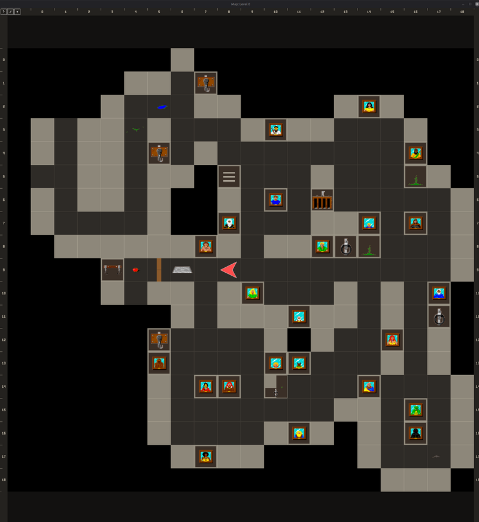
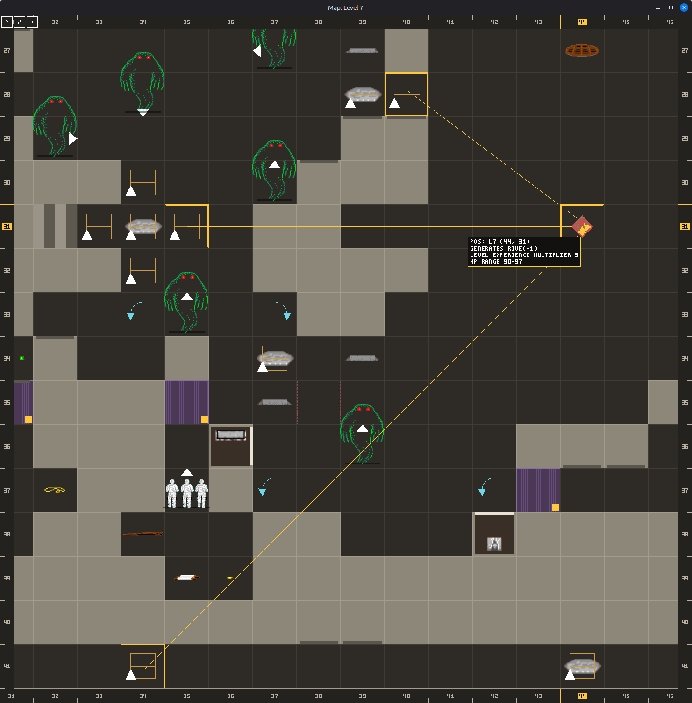
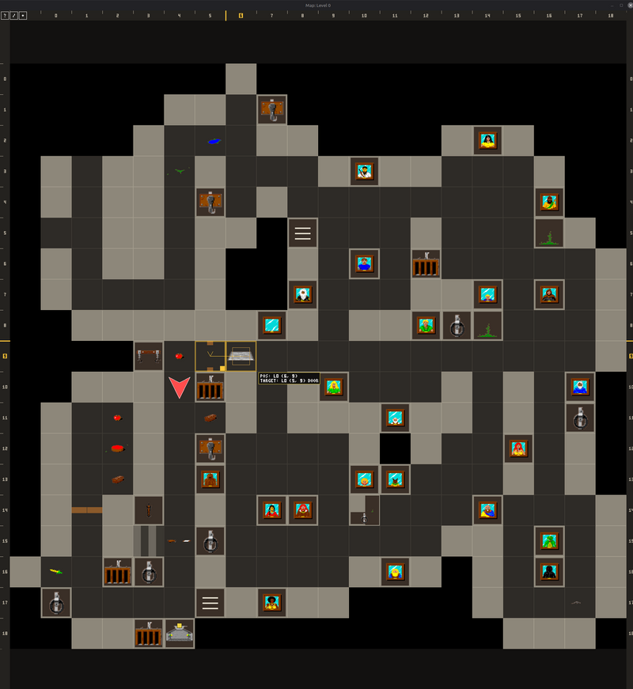

# Automap user manual

How to use the automap while you play. For how it is built, see
[automap.md](automap.md); for the exact rules of what counts as seen, see
[automap-visibility.md](automap-visibility.md).

## Contents

- [Opening the map](#opening-the-map)
- [The window](#the-window)
- [Moving around](#moving-around)
- [Vision and spoilers](#vision-and-spoilers)
- [What the map remembers](#what-the-map-remembers)
- [Tooltips](#tooltips)
- [Tracing switches and pads](#tracing-switches-and-pads)
- [Searching](#searching)
- [The legend](#the-legend)
- [Your own notes](#your-own-notes)
- [Saving](#saving)
- [Settings in csb.cfg](#settings-in-csbcfg)
- [Testing aids (debug mode)](#testing-aids-debug-mode)

## Opening the map

In the menu bar at the top of the game window, choose **Misc → Map → Window**. The map opens in a second
window that you can move and resize, and it updates while you play. If the
window was open when you left the game, it opens again the next time, at the
same place and size.

The **Misc → Map** menu also holds the display settings:

| Menu entry | What it does |
|---|---|
| **Window** | Shows or hides the map window |
| **Show level → Follow party** | The map shows the level the party is on (the default) |
| **Show level → Level n** | Locks the map to one level, wherever the party goes |
| **Vision** | Fog of war, Explored, live, or Whole level; see below |
| **Spoilers** | Seen, Learned or All; see below |
| **Highlight explored** | In Whole level vision, tints the cells the party has explored |

## The window

- The level is drawn with the game's own floor, wall, door, decoration, item
  and creature pictures, not with abstract tiles.
- The party is the red arrow, pointing the way it faces. Small white
  triangles show the way monsters face.
- **Rulers** run along all four edges and show the dungeon's coordinates. The
  row and column of the cell under the pointer are marked in yellow, so a
  position such as `L4 (12, 3)` is easy to read off.
- The buttons in the top-left corner are **?** for the legend and **/** for
  the search. With debug mode on, a third button, **+**, opens the testing
  aids.
- The window title names the level shown, for example `Map: Level 7`.

## Moving around

| Input | What it does |
|---|---|
| Mouse wheel | Zooms in and out |
| Middle-drag | Pans the view; the map stops following the party |
| Middle-click | Centres the view on the party again and follows it |
| Mouse side buttons | Back goes down a level, forward goes up, centred on the tile under the pointer |
| Page Down / Page Up | Goes down / up a level over the middle of the view |
| Ctrl+Page Down / Ctrl+Page Up | The same from the game window, where the plain keys pick up items in the default `csb.cfg` |
| **Misc → Map → Show level** | Picks a level, or follows the party again |

The side buttons are the quickest way to follow stairs and pits between
levels. They are the "back" and "forward" buttons of most five-button mice.

## Vision and spoilers

Two independent settings decide how much the map shows. **Vision** decides
*where* the map draws; **Spoilers** decides *how much it tells* about what it
draws.

| Vision | What is drawn |
|---|---|
| **Fog of war** (default) | Only the cells the party has explored. Monsters, missiles and spell clouds show only while the party can see them |
| **Explored, live** | The explored cells, with monsters and moving things shown live on all of them |
| **Whole level** | The whole level, explored or not. **Highlight explored** tints the explored part |

| Spoilers | What the map tells |
|---|---|
| **Seen** | Only what the 3D view has shown |
| **Learned** (default) | Also what the party has worked out by watching, such as which pad opened which door |
| **All** | Everything the dungeon holds, including what a switch will do before you press it |

At **Seen** and **Learned** the map keeps the dungeon's secrets the way the
game does:

- Wall decorations, switches, alcoves and writing appear only after the 3D
  view has shown enough of them to be noticed. Light matters: in the dark,
  less is noticed. Writing seen from afar is only scribbles, so it appears
  when you are close.
- The same goes for floor pictures (puddles, moss, pads) and stairs: a tile
  you only glimpsed past a corner shows as plain floor until you see what lies
  on it.
- Each item in an alcove appears on its own once it stood out; a cheese in
  the dark does not give away the bread beside it.
- A champion's mirror shows only its frame until you have stood in front of
  it, as the 3D view does.
- Hidden machinery (pads, relays, counters, generators, hidden pits,
  teleporters, false walls) stays hidden until the party learns of it.
- A chest's contents need the chest opened, and a scroll's text needs the
  scroll read.
- A breakable door looks like any other door.

### What the map draws

**Misc → Map → Show** switches kinds of things on and off: weapons, armour,
potions, scrolls, chests, food, keys, other items, monsters, wall decorations, wall
writing and floor decorations. **Show all** and **Hide all** set them all at
once. Hiding an item kind also hides it in alcoves and on altars. Floor
decorations are the dressing only (grates, moss, flame pits, cracks,
puddles): pressure pads and pits always show. Hidden things still turn up in
the search and in the tooltip.

**Misc → Map → Small wall decorations** (on by default) draws a wall
decoration as a small square against the face it hangs on, with a strip along
that face, so the stone around it still reads as wall and on a pillar you can
tell which face carries it. The strip is bright for a switch the map knows
about and quiet for everything else. Switched off, a lone decoration fills its
wall square, the larger picture of earlier versions, and keeps the strip on its
face. The choice holds at every spoiler level.

## What the map remembers

The map draws cells the way the party last saw them, not the way they are now.
A door that closed behind your back still shows open until you look again.

- **Cells:** doors open or shut, pits open or closed, and the floor and wall
  pictures.
- **Items** on the floor, where they were last seen. A `?` marks something only
  glimpsed in the dark.
- **Links** between a switch or pad and what it operates, once the party has
  seen the effect.
- **Damage** the game showed for each monster you fought.

## Tooltips

Hover a cell for a tooltip. What it lists depends on what is there and on the
spoiler level.

At every level:

- **Items**, stacked by name (`3X SKELETON KEY`), and what a chest or alcove
  holds once the party has looked.
- **Monsters**, with the damage the game showed for each group member.
- **Doors and stairs.**

From **Learned** on, also:

- **Links** from a switch or pad to the cells the party saw change.
- **The key a wall lock takes**, once a key in hand has opened it.

At **All**, also:

- **Where teleporters lead** and **how spinners turn** the party.
- **What every lock needs**, such as `NEEDS SOLID KEY (S)`.
- **What sets off a pad**, such as `TRIGGER: PARTY OR MONSTER`.
- **Monster generators**: what they create and its hit point range.
- **The monsters' hit points**, under the damage lines.
- **The whole press chain** of a switch or pad; see
  [Tracing switches and pads](#tracing-switches-and-pads).

Hovering a cell that something else acts on, such as a door or a generator,
draws lines from every switch and pad linked to it that the spoiler level
allows.

A tooltip that does not fit the window shows a `+N MORE` line. Hold **Shift**
and turn the wheel to scroll it.

## Tracing switches and pads

Hover a switch, lever or pad to see what it is linked to. At **Learned** the
map draws the links the party has seen work, with an open arrowhead: the party
saw the target change, not which signal did it.

At spoiler level **All** the map follows the whole chain. Hovering a switch or
pad walks its signal through relays, counters, gates and DSAs to the doors,
pits and walls at the end, through explored cells only. The tooltip then has
two parts:

- **THIS PRESS** lists what the next press reaches first, for example
  `L11 (47, 27) COUNTER A 3->2`.
- **PUZZLE** lists every goal behind it and how far it is, for example
  `FALSE WALL L11 (47, 26) OPENS IN 2 MORE`, `1 BIT OFF` or
  `BLOCKED: COUNTER AT 0`.

On the map each goal gets a ring and a badge: `NOW`, `2 MORE`, `1 BIT OFF`,
`NEEDS OTHERS`, `BLOCKED`, `HOLD`, `DSA` or `DONE`. Goals that happen now, soon
or already are yellow; those that wait on something else are orange. Hovering
a relay draws what feeds it in blue and what it feeds in yellow.

Hold **Shift** to see the whole relay tree, indented by depth, with delays and
gate modes.

## Searching

Press **/** or **Ctrl+F**, or click the **/** button, and type part of a
name. The search covers every level and finds items:

- on the floor, in a chest or in an alcove;
- that a pad or lock `NEEDS`;
- `CARRIED` by a monster (at spoiler level All only).

`FOOD` finds everything edible. Water fountains and the Altar of Vi are found
as wall features by name.

A hit reads like `L9 (12,21) KEY OF B NEEDS`. **Up** and **Down** step through
the hits and jump the map to each, **Enter** centres the selected hit, a click
on a hit jumps to it, and **Escape** closes the search. The wheel scrolls a
long list.

The search follows the same spoiler rules as the map: nothing in an unopened
chest and nothing beyond the explored cells is found.

## The legend

Click **?** to open the legend: every kind of mark the map draws, with its
meaning, in six pages: **GROUND**, **WALLS**, **PADS**, **TELEPORT**,
**LINKS** and **THINGS**. Each click on **?** or on the legend shows the next
page, and after the last it closes. The legend lists only what the current
spoiler level can draw and skips pages that would be empty.

## Your own notes

Right-click a cell the map shows to add your own guesses:

- **HIDDEN PIT (OPEN)** or **HIDDEN PIT (CLOSED)** on a plain floor tile.
- **LINK FROM HERE** on a floor tile or a wall face, to draw a connection you
  suspect. The map enters link mode: each left-click on a cell adds it as a
  target or removes it again. **Escape** or a right-click ends link mode.
- **REMOVE MARK** and **REMOVE LINKS** take your notes away again.

Notes are drawn in violet, at every spoiler level and on top of what the map
knows, so at All a guess sits beside the truth. The map never checks or
corrects them. Hovering a noted cell lists them at the end of its tooltip, for
example `YOUR MARK: HIDDEN PIT OPEN`.

## Saving

The map keeps its memory in a `.map` file beside each saved game, for example
`csbgame.dat.map`. It is written whenever you save the game and read when you
load it. Saved games without a `.map` file still load: the map simply starts
empty. Map files from older versions are upgraded when they are loaded.

## Settings in csb.cfg

The map keeps its settings under `[settings]` in `csb.cfg`. The game writes
most of them for you; only `map_debug` needs editing by hand.

| Key | Meaning | Default |
|---|---|---|
| `map_window` | `1` opens the map window with the game | `0` |
| `map_x`, `map_y`, `map_width`, `map_height` | The window's last position and size | set by the game |
| `map_vision` | `0` fog of war, `1` explored, live, `2` whole level | `0` |
| `map_spoilers` | `0` seen, `1` learned, `2` all | `1` |
| `map_follow` | `1` follows the party's level | `1` |
| `map_level` | The level shown when not following the party | `0` |
| `map_highlight` | `1` tints the explored cells in whole level vision | `0` |
| `map_small_decorations` | `1` small wall decorations by their face, `0` big tiles | `1` |
| `map_hide` | What **Show** leaves out, one bit each: 1 scrolls, 2 chests, 4 potions, 8 weapons, 16 armour, 32 other items, 64 monsters, 128 wall decorations, 256 wall writing, 512 floor decorations, 1024 food, 2048 keys | `0` |
| `map_debug` | `1` turns on the testing aids below | `0` |

## Testing aids (debug mode)

Set `map_debug = 1` under `[settings]` in `csb.cfg` to add tools made for
testing the automap. They are also handy for trying out a custom dungeon
without a drawer full of saved games.

- Right-click any tile for **TELEPORT HERE**, and one **SPAWN** row per monster
  type the level allows. A spawn asks how many, up to as many as fit on the
  tile, then the spot or quadrant, then the facing or any. Both work only on a
  cell the party could stand on; otherwise the title names the reason and the
  rows are greyed out.
- The **+** button beside **?** and **/** opens a panel with a row per champion
  and their `FIG`, `NIN`, `PRI` and `WIZ` levels. A click gives exactly one
  level in that skill. It is greyed out for a dead champion, a sleeping party
  or the level cap.
- **LIGHT** shows the view in the party's own light (`REAL n`) or in palette
  `0` to `5`, without changing what the game believes: monsters and light
  spells keep using the real light.
- **MONSTERS** `FROZEN` holds every monster that is not invincible still, on
  every level, so a view can be studied; `MOVE` releases them.
- **FORGET** `LEVEL` clears the explored cells, seen faces and remembered items
  of the shown level, `DUNGEON` those of every level, `LEARNED` the links and
  other learned facts, and `MARKS` your own notes.
- **MEASURE** `WALLS` redraws the party's level from every cell and facing and
  writes what stays visible to `automap-walls-L<level>.csv` and
  `automap-things-L<level>.csv`.

The map's memory changes at once; its `.map` file is rewritten when the game is
saved.
