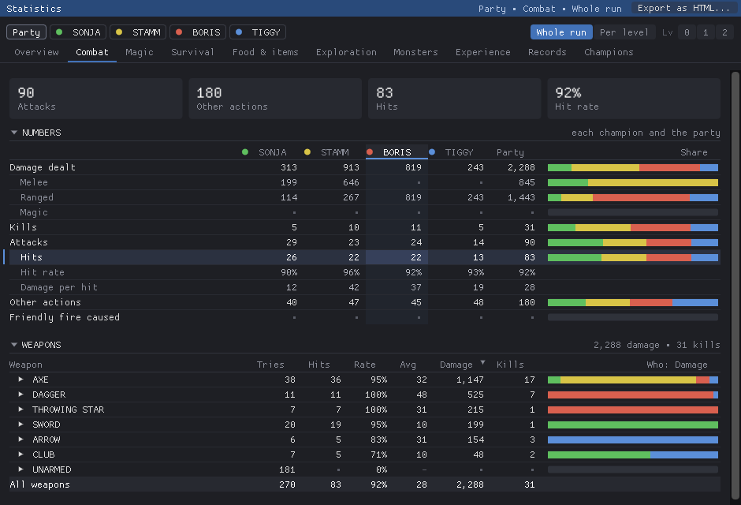
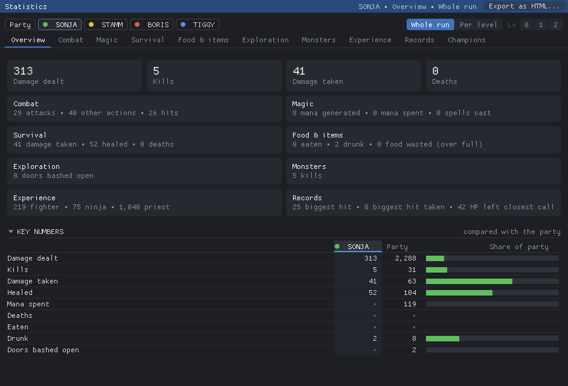
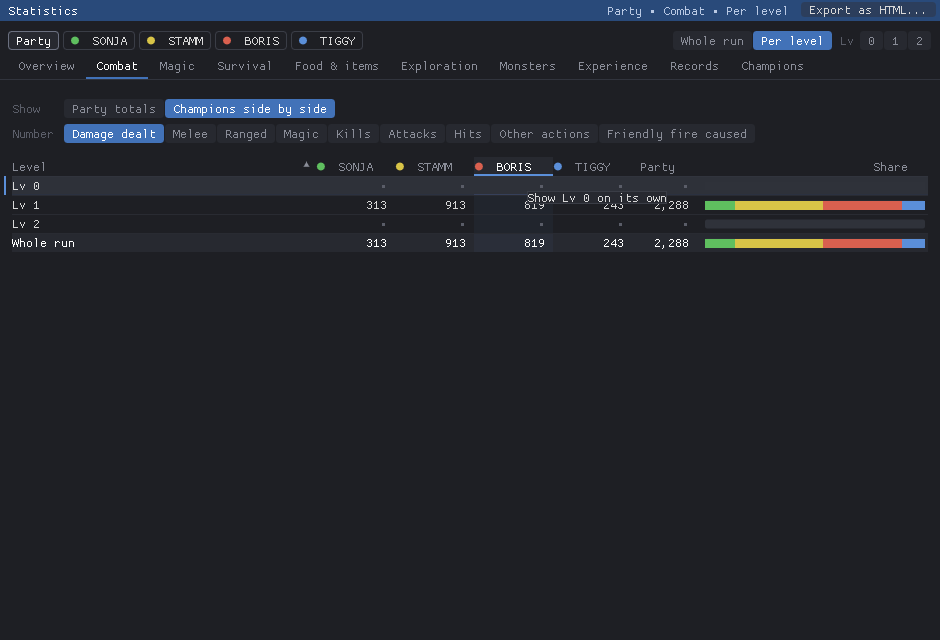

# Statistics user manual

The Statistics window shows what each champion did in the run: damage dealt and taken, kills,
attacks and spells, healing, mana, deaths, and how the party moved. It shows these for the whole
run and for each dungeon level. Like the map, it opens in a window of its own beside the game.
The numbers are saved with your game, so after loading a save you see the run as it was at that
save.

## Contents

- [Opening the window](#opening-the-window)
- [The window](#the-window)
- [Overview](#overview)
- [Combat](#combat)
- [Magic](#magic)
- [Survival](#survival)
- [Food & items](#food--items)
- [Exploration](#exploration)
- [Monsters](#monsters)
- [Experience](#experience)
- [Records](#records)
- [Champions](#champions)
- [Per level](#per-level)
- [Numbers](#numbers)
- [Sorting](#sorting)
- [Sharing: export as HTML](#sharing-export-as-html)
- [What is counted, and how](#what-is-counted-and-how)
- [Saving and reloading](#saving-and-reloading)
- [Settings in csb.cfg](#settings-in-csbcfg)

## Opening the window

In the menu bar of the game window, choose **Misc → Statistics**. Choose it again to
close the window, or use the window's own close button. If the window was open when you left the
game, it opens again at the same place and size the next time.

When you win, the window opens by itself and shows the whole run.

The keys keep steering the game while the Statistics window is in front, as they do with the
map.

To make everything in the window bigger or smaller, hold **Ctrl** and turn the mouse wheel over
the window, or press **Ctrl +** and **Ctrl −** with the pointer over it. **Ctrl 0** goes back to
100 %. The zoom goes from 70 % to 250 %, the window's title shows it when it is not 100 %, and it
is kept for the next time.

## The window

The window has three controls that never move:

- **Who**, the first row on the left: **Party**, then one button per champion with their colour,
  the game's own champion colours (green, yellow, red, blue by party slot). The champions in the
  party come first, in their slot order. In custom dungeons a champion can leave the party; such a
  champion is shown greyed out after the others, can still be picked, and still counts in the
  Party's numbers.
- **The level**, the first row on the right: **Whole run** (everything since the game began),
  **Per level** (see [Per level](#per-level)), or one level number. A level counts once the party
  has stood on it; the levels are numbered as the map numbers them, starting at 0. With more than
  16 visited levels (large custom dungeons such as Conflux) the numbers become **◀ list ▶**: the
  arrows step to the previous or next visited level, and the list jumps to any of them.
- **The topic**, the tabs under them: **Overview**, **Combat**, **Magic**, **Survival**,
  **Food & items**, **Exploration**, **Monsters**, **Experience** and **Records**. The tabs are the
  same whoever is picked. After them comes **Champions**, which is not a topic of the statistics
  but the party as it is now (see [Champions](#champions)).

The **title strip** shows what you are looking at ("SYRA · Combat · Lv 3") and holds the
**Export as HTML...** button (see [Sharing](#sharing-export-as-html)).

Every topic is built the same way:

1. **Tiles** at the top: the topic's main numbers.
2. **Numbers**: every number of the topic. For the Party there is one column per champion, the
   Party column, and a **Share** bar that splits the number in the champions' colours. For a
   champion there is their column, the Party column, and **Share of party**, a bar of their part.
   Numbers kept only for the party as a whole (steps, chests opened ...) show for the Party only.
   A row indented further and greyed is a part of the row above it. Hover a number's name for a
   word on what it counts, where there is one.
3. **Detail tables** of the topic (weapons, spells, sources of damage, monsters ...). For the
   Party they have a **Who** bar: how the line splits among the champions. Its header says what it
   splits: the column the table is sorted by, when that can be split (Weapons and Spells by Damage,
   Kills, Casts ...; Eaten and drunk by Eaten or Drunk), otherwise the table's main number
   (Damage for Weapons, Mana for Spells). Click a column's header to sort by it and split by it.
   Hover a bar for each champion's number.

Click a section's title to fold or open it; the window remembers which sections are folded.

Throughout the window:

- a **dim dot** (·) is a zero; a **-** is a rate or an average with nothing to work it out from,
  for example a hit rate without attacks;
- a number on a **red pill** is bad news: friendly fire, deaths, wasted mana, food wasted (in a
  big tile at the top just in red);
- the last row of a table, shaded, is its total.

## Overview

For the **Party**: tiles with the damage dealt, kills, deaths and tiles explored; a **card per
champion** with their share of the party's damage and small bars for damage, kills, damage taken,
healing, mana spent and deaths (each bar against the best champion); and **Key numbers**, one
row from each topic. Click a card to see that champion.

For a **champion**: their damage, kills, damage taken and deaths; a **tile per topic** with its
main numbers (click one to open the topic); and the Key numbers next to the party's.

The tiles of every topic and the Key numbers can be chosen in `csb.cfg`, see
[Choosing the tiles and the Key numbers](#choosing-the-tiles-and-the-key-numbers).

## Combat

| Number | What it counts |
|---|---|
| **Damage dealt** | with **Melee**, **Ranged** and **Magic** below it (see [What is counted](#what-is-counted-and-how)) |
| **Kills** | monsters the champion's blow finished |
| **Attacks** | blows and missiles aimed at a monster; with **Hits**, **Hit rate** (hits per attack) and **Damage per hit** below it |
| **Other actions** | the actions that cannot hit: WAR CRY, CALM, BRANDISH, BLOW HORN, the shields ... (see Weapons below). They are no attacks, so they are not in Attacks or the hit rate. |
| **Friendly fire caused** | damage the champion's missiles, spells and explosions did to the party |

**Weapons** lists the attacks by weapon, with each action (SWING, CHOP, THRUST, SHOOT ...) below
it; click a weapon to show its actions. Columns: Tries, Hits, Rate (hits per try), Avg (damage per
hit), Damage, Kills.

- Actions with an empty hand (PUNCH, KICK, WAR CRY) are listed under **UNARMED**.
- Actions that cannot hit are listed too: WAR CRY, CALM, BRANDISH, BLOW HORN, CONFUSE, the shields
  and spells of wands and staffs that make no missile (SPELLSHIELD, FIRESHIELD, LIGHT, FREEZE LIFE,
  FLUXCAGE ...), CLIMB DOWN and the like. Their Tries count how often you used them; Hits, Damage
  and Kills are zero and Rate and Avg show "-", as there is nothing to work them out from. They
  are left out of a weapon's hit rate, so a War Cry does not lower your punches' rate. Their
  Tries are in the table's Tries, so All weapons' Tries is Attacks and Other actions together.
- Throwing an item is listed under the item itself: **THROW** when you chose the THROW action of
  the weapon hand, **Throw (by hand)** when you threw it from the mouse pointer. A shot belongs to
  the bow, crossbow or sling, not to the arrow.
- Only attacks aimed at a monster count as tries; swinging at an empty square does not.
- Spells entered as runes are no attacks: they are under [Magic](#magic).

## Magic

| Number | What it counts |
|---|---|
| **Mana generated** | with **Regeneration** and **Mana potions** below it |
| **Mana spent** | counted as each rune is entered, as the game takes it, whatever becomes of the spell; below it what became of that mana, which adds up to it: **Spells** (split into **Successful casts** and **Wasted on failures**), **Runes cleared** and **Not cast yet** |
| **Spells cast** | every attempt; with **Successful** and **Failed** below it, which add up to it |

**Spells** has one row per spell, all power levels together (Lo Ful Ir and Mon Ful Ir are both
"Fireball"). Columns: **Casts** (every attempt), **Failed** (needs more practice, fizzled, no flask
for a potion ...), **Mana** (the runes of every cast, the failed ones included), **Wasted** (the
failed casts' part of it), and the **Damage** and **Kills** of the spell, including the cloud or
explosion it made. Extra rows: runes that form no spell ("Ful Bro Ku (no spell)"), **Shield
action**, **Heal action** and **Spells from items** (staffs and wands).

**Runes cleared** is no spell, so it is not in this table: it is the mana of runes entered and
never cast (taken back with the arrow, replaced by a new incantation, or lost when the caster died;
the game does not refund it). It is under Mana spent instead, with **Not cast yet**: runes waiting
in an incantation, whose mana is spent already.

**Which level.** Mana counts on the level where the runes were entered, and so does what became
of it (the four lines under Mana spent); a spell in the Spells table counts on the level where it
was cast. Enter a fireball's runes, sleep, take the stairs and cast it below: the mana is spent on
the level above, the fireball is cast on the level below. For the whole run the Mana of **All
spells** is the **Spells** line under Mana spent: Successful casts (staffs, wands and actions
included) plus Wasted on failures.

## Survival

| Number | What it counts |
|---|---|
| **Damage taken** | after armour and resistances |
| **Healed** | HP actually gained; with **Regeneration**, **Potions** and **Heal action** below it |
| **Healing given** | HP healed by potions the champion brewed, whoever drank them |
| **Deaths**, **Resurrected** | how often the champion died and was brought back |
| **Party wiped out**, **Reloads** | for the Party and the whole run only |

**Damage taken by source**: one line per source. **Monster attacks** are the blows of monsters
(claws, weapons, bites), all monsters on one line. Spells and missiles that monsters cast are
listed by what they are and who cast them: **Fireball (Lord Order)**, **Lightning (Vexirk)**,
**Poison bolt**, **Poison blob**, **Poison cloud** ... Then **Friendly fire** (from whom, or
"own"), **Poison**, **Pits**, **Walls**, **Doors**, **Starvation**, **Exhaustion**, **Traps**,
**Harmful potions or food**.

**Healing by source**: regeneration, the Heal action and potions (from whom, own, or found in the
dungeon).

**Deaths** lists each death with its cause and level, for example "Fireball from Lord Order · Lv
3", "own Fireball · Lv 9", "Fell into a pit · Lv 7". The Party's list names the champion.

## Food & items

| Number | What it counts |
|---|---|
| **Eaten**, **Drunk** | everything eaten and drunk; drinks straight from a fountain count as drunk |
| **Food gained**, **Water gained** | how much the champion's food and water actually rose, in the game's own units (a champion is full at 2048; an apple gives 500, a water flask 1600, a gulp from a waterskin 800, a fountain 1600) |
| **Food wasted (over full)**, **Water wasted (over full)** | the part that went over full and was lost. An apple worth 500 eaten by a champion 200 short of full gains 200 and wastes 300. |
| **Items picked up** | items the party took from the dungeon into the hand, the first time only (Party) |
| **Used in walls** | items a wall took: keys in locks, coins and gems in slots (Party) |

**Eaten and drunk** has one row per item (APPLE, CORN, WATERSKIN, potions ..., and **Fountain**).
A gulp from an empty waterskin or flask does not count.

**Items** (Party only) has one row per item name:

- **Picked up**: from the floor, an alcove, a torch holder, an alcove that swaps one item for
  another, a gift from the gods, or an open chest. An item counts only **the first time** the party
  holds it, so dropping a dagger and picking it up again does not count twice. An item changed
  into another one is a new item: the Firestaff that takes the Power Gem is **THE FIRESTAFF (with
  Power Gem)**, with its own line here and in Weapons. Two kinds of item that share a name in a
  custom dungeon are told apart by a number, "(2)". A charged item that runs out of charges, or
  is recharged on an altar of Vi, stays the same item. What the champions
  carried when they joined is not counted.
- **From chest**: of the items picked up, the ones taken out of an open chest. Taking a whole chest
  does not count what is inside; each item counts when it is taken out.
- **Used in walls**: keys in locks, coins and gems in slots, and anything else a lock in a custom
  dungeon takes.

## Exploration

Most of these are the party's, not a champion's; a champion's Exploration shows the doors only.

| Number | What it counts |
|---|---|
| **Steps** | Moves you made to another square: forward, back, sideways, and up or down stairs |
| **Tiles walked** | The different squares the party stood on, however it got there; each square counts once |
| **Tiles explored** | The squares the map shows as explored that are not solid wall: floors, doors, stairs, pits, teleporters ... A false wall counts once it is seen to be passable. This comes from the map itself, so it is there for games saved before the statistics existed. |
| **Turns** | Turns left or right you made. Turning while on stairs takes the stairs, so it counts as a step. |
| **Wall bumps** | Moves that ran into a wall, a closed door or a solid false wall |
| **Teleports** | Teleporters that moved the party. Each teleporter in a chain counts. |
| **Pit falls** | Pits the party fell into. Each pit of a chain counts, on the level of the pit. |
| **Pit climbs** | Pits the party climbed down with a rope (its CLIMB DOWN action), so nobody was hurt. Pits further down the same shaft are falls. |
| **Time (ticks)** | Game ticks spent on the level, by the game's own clock, with **Asleep (ticks)** below it. How long a tick lasts in real time depends on the game speed. |
| **Doors bashed open** | Doors a champion broke down ("bashed" is the game's own word), with **Smashed** (an attack), **Shot open** (a thrown or fired item) and **By spell** (a spell's missile or its explosion) below it. Doors broken by monsters or traps are not counted. |
| **Opened with Zo** | Closed doors a champion's Zo spell opened: the spell works the door's switch like its button and leaves the door whole, so these are not bashed. A Zo on an open door closes it and does not count. |
| **Opened with button**, **Closed with button** | Clicks on a door's button: a click on an open door closes it, a click on any other door opens it. Doors moved by levers, wall switches, pressure plates or scripts are not counted. |
| **Chests opened** | each chest once, the first time the party opens it |
| **Scrolls read** | each scroll once, the first time it is opened |
| **Wall texts read** | the wall texts the map knows as read |
| **Champions seen**, **Champions viewed** | portraits in mirrors seen face to face, and mirrors clicked to look at the champion; each mirror counts once, and the champions you took into the party count too, although their mirror is empty afterwards |

Only what you did counts as steps and turns. Falling, climbing down, being teleported or being
moved by a script is not a step. Movement and the other party numbers count from the start of a
new game, before the first champion joins.

## Monsters

The numbers: **Kills** (by the champions), **Crushed by doors**, **Killed by falls** and
**Other causes** (clouds nobody is known to have made, traps, other monsters, the game removing them).

**Monsters killed** has one row per kind of monster. For the Party: one column per champion,
**Door**, **Pit** and **Other** when something was killed that way, **All**, and a **Who** bar.
For a champion: the monsters they killed. Monsters carry the names the dungeon gives them; kinds
that look alike (variants the dungeon gives no name of their own) share one row.

## Experience

The experience each champion gained in **Fighter**, **Ninja**, **Priest** and **Wizard**, where it
came from, and the ranks it brought. It is the experience the game added: with the level's
multiplier (deeper levels give more), the bonus for training in a fight, and whatever a custom
dungeon's own rules change. The game never shows these numbers; the ranks are the ones the
inventory shows (Neophyte, Novice ... Expert, Lo Master ... Mon Master, Archmaster).

Each class has four hidden skills, and what trains them trains the class:

| Class | Hidden skills |
|---|---|
| Fighter | Swing, Thrust, Club, Parry |
| Ninja | Steal, Fight, Throw, Shoot |
| Priest | Identify, Heal, Influence, Defend |
| Wizard | Fire, Air, Earth, Water |

**Tiles.** For the Party: each class's experience, and the best rank in it with the champion
who has it. For a champion: their rank in each class now, the experience they gained in it, and a
bar of the way to the next rank.

| Number | What it counts |
|---|---|
| **Experience gained** | with **Fighter**, **Ninja**, **Priest** and **Wizard** below it, which add up to it |
| **Ranks gained** | new ranks reached, in any class |

**Skills** has a row per class; click it to see its hidden skills. A gain the game gave the class
itself, not one of its skills, shows as "Fighter itself" and the like. For a champion the table
shows the rank now, with the rank they had when the statistics first knew them.

**Experience by source** shows where the experience came from. Click a line with a triangle to fold
or open it:

- **Attacks**: blows, shots and throws, by weapon, each action with the class and hidden skill it
  trained ("SWING Fighter · Swing").
- **Monsters attacking you**: each time a monster attacks a champion, hit or miss, the champion
  gains Parry (Fighter). A hit taken gives no experience of its own.
- **Other actions**: War Cry, Calm, Brandish, Blow Horn and the like. They train Influence (Priest).
- **Spells**: by class (Priest, Wizard), each spell with the hidden skill it trained. A spell that
  fails ("needs more practice") gives experience too.
- **Other**: items and scripts of the dungeon that raise a skill.

**Ranks gained** lists each new rank, newest first: the champion, the class, the rank
("Artisan → Adept"), what earned it and the level.

Experience counts on the level where it was gained.

## Records

The best moments of the run. Each record keeps the champion, how (the weapon and action, the
spell), on or from whom, the level, and the game time (hover the value). When two are equally good,
the earlier one stays.

| Record | What counts |
|---|---|
| **Biggest hit** | the most damage a blow, a thrown item or a shot did to one monster, as the game shows it |
| **Biggest spell hit** | the most damage one monster took from one spell (an explosion, or a tick of its cloud) |
| **Biggest spell in all** | one spell's damage to the whole group: a fireball doing 210 to each of four monsters is 840 |
| **Most kills at once** | monsters killed by one blow, one explosion or one tick of a cloud |
| **Kills without a scratch** | the most kills in a row with no damage taken in between |
| **Biggest hit taken** | the most damage one monster attack did to a champion, after armour |
| **Biggest spell hit taken** | the most damage one monster spell or missile did |
| **Closest call** | the fewest hit points a champion had left after taking damage and living, and what did it |
| **Biggest heal** | the most hit points gained at once: a potion, the Heal action, regeneration |
| **Most mana on one spell** | the mana of the runes of one spell that worked |
| **Biggest experience gain** | the most experience gained at once, with what earned it |
| **Heaviest load** | the most weight a champion carried, and the share of what they could carry |
| **Longest fall** | pits fallen through one after the other (the party) |
| **Longest teleport chain** | teleporters one after the other (the party) |
| **Longest sleep** | the ticks of one sleep (the party) |

**Kills without a scratch.** The kills are the ones credited to a champion; monsters crushed by
doors, killed by falls or by other causes do not count. Any damage a champion takes ends the streak:
monsters, their spells, friendly fire, poison, pits, traps, starvation. For the Party it is the
kills of anyone until any champion is hurt; for a champion, their own kills until they themselves
are hurt. A streak goes on across levels; its level is the level of its last kill. **On / from**
names the monsters it killed most.

A step or a turn ends a fall or a teleport chain.

For the **Party**, the table shows the best of the run and who holds it. For a **champion**, it
shows their own best, and the party's best beside it; a record the champion holds for the party is
gold with a ★. The party's own records (falls, teleports, sleep) are not on a champion's page.

**Records go back with a reload** like the other numbers: a hit you reloaded away did not happen.

## Champions

The last tab shows the champions as they are **now**, what the game's own inventory screen shows
of each: health, stamina and mana (bars in the champion's colour), food and water, the load
against what the champion can carry, wounds, poison, the six attributes (current and max; drained
in red, raised above the max in gold), the rank in each class with the way to the next rank, and
every item carried, slot by slot, with a chest's contents under it. The **Party** shows every
champion one under the other and the item on the cursor; a champion shows only them.

It only reads the champions: nothing is opened or changed in the game. That makes it the way to
look into the champions while **watching a replay**, someone else's included: the replay stays in
step with its recording. The level picker is hidden on this tab; it has no levels.

The HTML export has the tab too, with the champions as they were when it was written.

## Per level

**Per level** in the level picker shows the topic one row per visited level, with the **Whole
run** in the last row. Click a level's row to see that level on its own.

For the Party, **Show** chooses between two tables:

- **Party totals**: the topic's numbers for the whole party, one column each, and a **Who** bar
  that splits the topic's first champion number (damage dealt in Combat, for example).
- **Champions side by side**: one number, picked with the **Number** buttons, with one column per
  champion, the Party, and a **Share** bar. Only the numbers kept per champion that can be added
  up are offered: a hit rate or the party's steps cannot be split by champion.

For a champion, Per level shows that champion's numbers of the topic.

On **Records** the Party's Per level has no Show: it is one record, picked with the **Number**
buttons, a column per champion with their best on each level and the Party's best, without a
Share bar.

## Numbers

Numbers above 999 are written with a comma between the thousands, for example 4,261. The
`stats_separator` entry in `csb.cfg` changes that, see [Settings](#settings-in-csbcfg). The HTML
export uses the same.

## Sorting

Click a column's header to sort a table by it. Click it again to reverse the order. The small
triangle shows the column and the direction. Numbers sort largest first on the first click, names
alphabetically. The total row always stays at the bottom, and a weapon's actions stay below it,
sorted the same way.

All tables sort except **Numbers**, **Key numbers**, and the tables of Experience and Records, which
keep their order so that the parts stay under their row: Skills by class, Experience by source and
Ranks gained most first and newest first, Records in their groups.

## Sharing: export as HTML

Click **Export as HTML...** in the title strip. The game writes a file named like
`statistics-2026-10-31-153000.html` into the game folder (the folder the game was started in,
where `csb.cfg` is), and tells you where. Click **Open** in that message to look at it in your web browser.

The file is a copy of the Statistics window as a web page:

- every topic for the party and for every champion, every visited level and Per level, with
  folding sections and sortable tables;
- the champions' names, the dungeon file and the date at the top;
- one file with nothing else needed and nothing loaded from the internet. Send it to a friend or
  attach it to a forum post.

It holds the numbers as they were when you clicked; export again for newer numbers.

## What is counted, and how

- **Damage is the number the game shows**: the attack panel, PROJECTILE DAMAGE, SPELL DAMAGE. A hit
  of 90 on a monster with 10 HP left counts 90.
- **Melee, ranged, magic**: melee is a weapon or empty hand at close range; ranged is a thrown
  item or a shot; magic is a spell, including spells from staffs and wands, and the clouds and
  explosions they make.
- **A kill** goes to the champion whose blow finished the monster, whether melee, missile, spell
  or the poison cloud the spell left.
- **Friendly fire**: damage from a champion's missile, spell or explosion that hits the party
  (the caster included). It is not damage dealt. It counts as "Friendly fire caused" for the
  champion who caused it and as damage taken for the one it hurt.
- **Damage taken** is the damage after armour and resistances.
- **Healed** counts HP actually gained, never more than was missing.
- **Mana spent** is counted rune by rune as the runes are entered, as the game takes it, on the
  level they were entered on; a spell's mana is the sum of its runes, on the level of the cast.
  Runes still waiting in an incantation are kept in the save and come back when it is loaded.
- **Cloud damage** is the hit points the monsters actually lost: the game draws each monster's
  share of a cloud's damage at random and never shows it.
- Everything is counted on the level the party is on when it happens.
- Stats belong to the **champion**, not to the slot in the party: a champion who moves to another
  slot keeps their numbers.

## Saving and reloading

The statistics are stored in the save's `.map` companion file (the same file the map uses), so
they need no extra step. Loading a save brings back the numbers of that save.

**Hardship survives reloads.** Deaths, resurrections, party wipes and the reload count stay when you load an
earlier save of the same game, so you cannot hide a death by reloading. Everything else goes
back to what it was at that save.

Saves from before the statistics existed load with empty statistics; counting starts from there.
Saves made before Movement was counted show 0 for the time before; saves made before wall bumps,
pits, sleep and the actions that cannot hit were counted show 0 for those. Saves made before items
were counted show none; from such a save on, the items the champions carry count as already held.
Saves made before eating, drinking, bashed doors and opened chests were counted show 0 for those;
a chest opened before still counts the first time it is opened again. Saves made before food,
water and the way a door was broken were kept show 0 for those; their doors count only in Doors
bashed open. Saves made before tiles walked were kept count them from the first square after loading. Saves
made before scrolls read were kept count each scroll the first time it is opened after loading;
wall texts read, champions seen and champions viewed come from the map and are there for old
saves too. A champion portrait is not a wall text, even though the map marks both the same way.
Saves made before experience and records were kept show none: experience counts from the first
load, the ranks "at the start" are the ranks then, and the ranks now are always the champions' own.

## Settings in csb.cfg

The window keeps these in the `[settings]` section of `csb.cfg`:

| Entry | Meaning |
|---|---|
| `stats_window` | 1 when the window was open when the game was left |
| `stats_x`, `stats_y`, `stats_width`, `stats_height` | The window's place and size |
| `stats_page` | The topic last chosen: 0 Overview, 1 Combat, 2 Magic, 3 Survival, 4 Food & items, 5 Exploration, 6 Monsters, 7 Experience, 8 Records |
| `stats_layout` | 2: `stats_page` holds a topic. Without it, `stats_page` is read as the front page of earlier versions (3 Monsters, 4 Items; the others open the Overview). |
| `stats_separator` | The mark between thousands: `comma` (4,261, the default), `dot` (4.261), `space` (4 261), `apostrophe` (4'261) or `none` (4261). Edit it while the game is closed. |
| `stats_zoom` | The zoom in percent: 70, 80, 90, 100 (the default), 110, 125, 150, 175, 200 or 250. Another number is taken as the nearest of these. |
| `stats_closed` | Which sections are folded, added up: 1 Weapons, 2 Spells, 4 Damage taken by source, 8 Healing by source, 16 Deaths, 32 Eaten and drunk, 64 Items, 128 Monsters killed, 256 Numbers, 512 Key numbers, 1024 Skills, 2048 Experience by source, 4096 Ranks gained, 8192 Records; 0 none |

Who is picked, Per level and its choices are not kept: the window opens on the Party.

### Choosing the tiles and the Key numbers

These entries choose which numbers the window shows at the top of each topic and in Key numbers.
Each is a list of number names (see below), split by commas or spaces. The game writes the
defaults into `csb.cfg` the first time, so they are there to change. Edit them while the game is
closed: the game writes `csb.cfg` again when you leave it.

| Entry | Meaning | Default |
|---|---|---|
| `stats_tiles_overview` | The tiles of the Party's Overview | `damage, kills, deaths, tiles_explored` |
| `stats_tiles_champion` | The tiles of a champion's Overview | `damage, kills, taken, deaths` |
| `stats_tiles_combat` | The tiles of Combat | `damage, kills, hit_rate, friendly_fire` |
| `stats_tiles_magic` | The tiles of Magic | `mana_generated, mana_spent, casts, mana_wasted` |
| `stats_tiles_survival` | The tiles of Survival | `taken, healed, deaths, resurrected` |
| `stats_tiles_food` | The tiles of Food & items | `eaten, drunk, food_wasted, picked_up` |
| `stats_tiles_exploration` | The tiles of Exploration | `tiles_explored, steps, ticks, doors_bashed` |
| `stats_tiles_monsters` | The tiles of Monsters | `kills, door_kills, pit_kills, other_kills` |
| `stats_tiles_experience` | The tiles of Experience | `fighter, ninja, priest, wizard` |
| `stats_tiles_records` | The tiles of Records | `biggest_hit, biggest_spell_total, biggest_hit_taken, closest_call` |
| `stats_key_numbers` | The rows of Key numbers, in their order (at most 24) | `damage, kills, taken, healed, mana_spent, deaths, eaten, drunk, doors_bashed, steps, tiles_explored, ticks` |

- A topic shows at most 4 tiles; names after the fourth are left out.
- A topic's tiles are also its line on a champion's Overview: the first three that have a value.
- Any number can go in any list, also one from another topic.
- A number kept only for the party (steps, chests ...) shows for the Party and is left out for a
  champion.
- A name the game does not know is left out. A list with no name it knows, or an empty one,
  shows the defaults.
- A line of `csb.cfg` holds at most 255 characters.
- The HTML export shows the same tiles and Key numbers.

**The names:**

| Topic | Names |
|---|---|
| Combat | `damage`, `melee`, `ranged`, `magic`, `kills`, `attacks`, `hits`, `hit_rate`, `damage_per_hit`, `other_actions`, `friendly_fire` |
| Magic | `mana_generated`, `mana_regeneration`, `mana_potions`, `mana_spent`, `mana_on_spells`, `mana_successful`, `mana_wasted`, `runes_cleared`, `runes_not_cast`, `casts`, `casts_successful`, `casts_failed` |
| Survival | `taken`, `healed`, `heal_regeneration`, `heal_potions`, `heal_action`, `healing_given`, `deaths`, `resurrected`, `wipes`, `reloads` |
| Food & items | `eaten`, `drunk`, `food_gained`, `food_wasted`, `water_gained`, `water_wasted`, `picked_up`, `used_in_walls` |
| Exploration | `steps`, `tiles_walked`, `tiles_explored`, `turns`, `wall_bumps`, `teleports`, `pit_falls`, `pit_climbs`, `ticks`, `sleep_ticks`, `doors_bashed`, `doors_smashed`, `doors_shot`, `doors_by_spell`, `doors_by_zo`, `doors_button_opened`, `doors_button_closed`, `chests`, `scrolls`, `wall_texts`, `champions_seen`, `champions_viewed` |
| Monsters | `kills`, `door_kills`, `pit_kills`, `other_kills` |
| Experience | `experience`, `fighter`, `ninja`, `priest`, `wizard`, `ranks_gained` |
| Records | `biggest_hit`, `biggest_spell_hit`, `biggest_spell_total`, `most_kills_at_once`, `kill_streak`, `biggest_hit_taken`, `biggest_spell_hit_taken`, `closest_call`, `biggest_heal`, `most_mana_on_spell`, `biggest_experience_gain`, `heaviest_load`, `longest_fall`, `longest_teleport_chain`, `longest_sleep` |

Each name is the number of the same label in that topic's Numbers: `heal_potions` is Potions under
Healed, `mana_on_spells` is Spells under Mana spent, `ticks` is Time (ticks).
